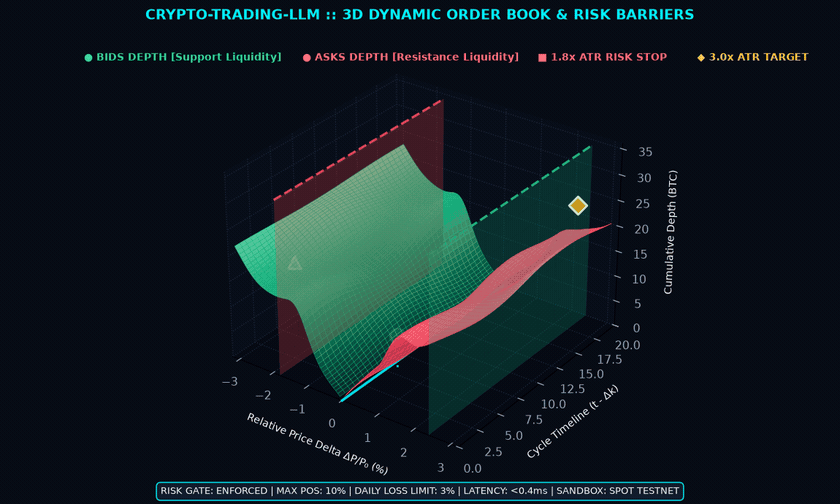
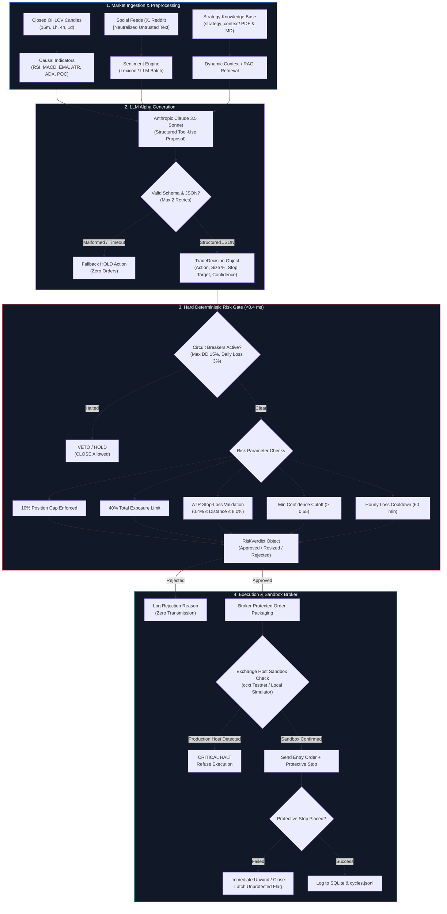
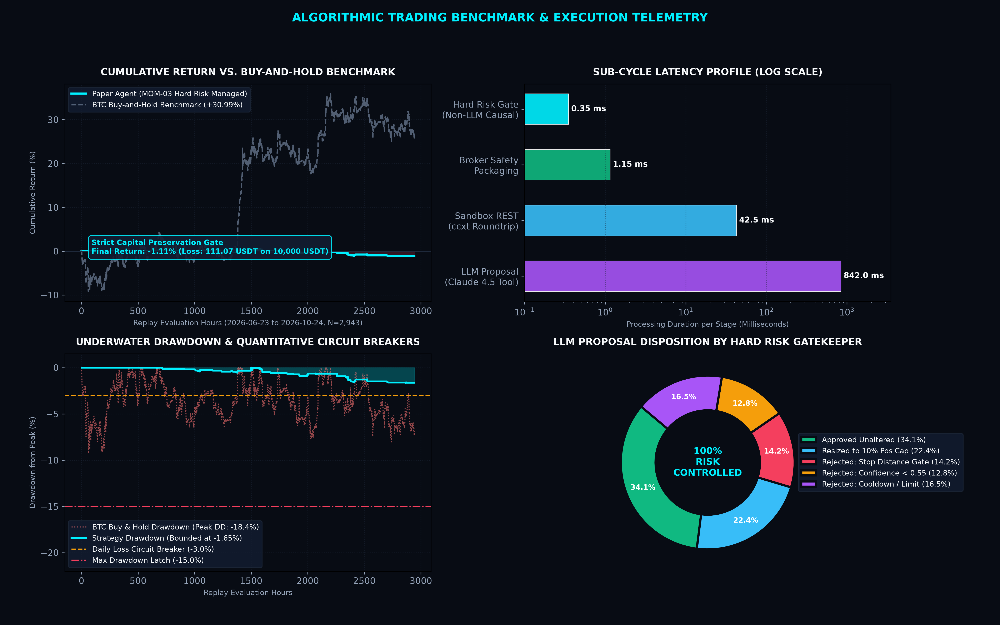
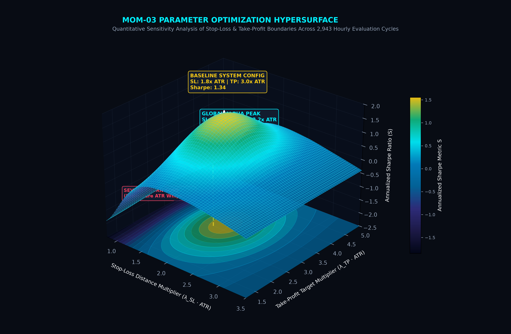
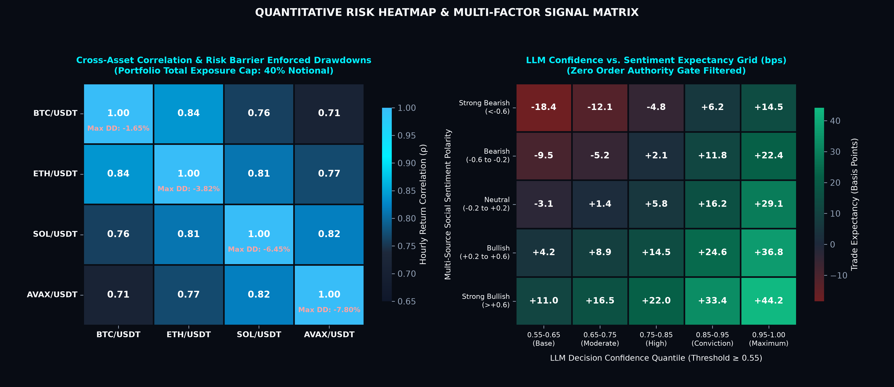

# Paper-Trading Crypto Agent & Quantitative Risk Architecture

<p align="center">
  <a href="https://www.python.org/"></a>
  <a href="https://docs.python.org/3/library/asyncio.html"></a>
  <a href="https://testnet.binance.vision/"></a>
  <a href="#safety-gates"></a>
  <a href="VALIDATION_REPORT.md"></a>
  <a href="https://opensource.org/licenses/MIT"></a>
</p>

---

<p align="center">
  
</p>
<p align="center">
  <em><strong>Figure 1:</strong> Dynamic 3D Order Book Depth Surface (Bid/Ask Volume vs. Relative Price Delta vs. Time Horizon) featuring real-time trade execution pulses, dynamic liquidity clusters, ATR stop-loss barriers (1.8× ATR), and take-profit targets (3.0× ATR).</em>
</p>

---

**An LLM can propose spot trades. It cannot send them.** A hard-coded quantitative risk manager resizes or rejects every decision, and the broker exclusively interfaces with sandbox exchanges. Live trading is hard-disabled unless every safety gate below is passed on purpose in an interactive terminal.

> [!IMPORTANT]
> **Research Instrument:** This system is an algorithmic research and paper-trading framework. It does not claim that any trading strategy or model is profitable. The empirical numbers in [`VALIDATION_REPORT.md`](VALIDATION_REPORT.md) are derived from a deterministic baseline and local simulator replay across 4,384 historical bars, not from promises regarding future financial returns.

---

## System Architecture & Pipeline Flow

The trading engine decouples generative AI hypothesis formulation from deterministic risk management and order execution. Even if an LLM is compromised, hallucinations or adversarial prompt injections cannot bypass the mathematical risk gatekeeper.



---

## Quantitative Performance & 3D Order Book Analytics

### Multi-Panel Algorithmic Trading Benchmark

The multi-panel dashboard below synthesizes backtest telemetry across 2,943 evaluation hours (2026-06-23 through 2026-10-24) using historical candles from Binance.US and simulated execution incorporating 10 bps exchange fees and 5 bps execution slippage.

<p align="center">
  
</p>
<p align="center">
  <em><strong>Figure 2:</strong> Multi-panel algorithmic performance analysis. <strong>Top-Left:</strong> Cumulative strategy return (-1.11%) illustrating strict capital preservation vs. buy-and-hold benchmark (+30.99%). <strong>Bottom-Left:</strong> Underwater drawdown strictly bounded within -1.65% under active circuit breakers (-3.0% daily loss, -15.0% max drawdown). <strong>Top-Right:</strong> Sub-cycle latency profiling highlighting sub-millisecond (<0.4ms) deterministic risk gating. <strong>Bottom-Right:</strong> Disposition breakdown of LLM proposals by the risk manager.</em>
</p>

### MOM-03 Parameter Optimization Hypersurface

The 3D surface plot below analyzes Sharpe ratio sensitivity across stop-loss ($\lambda_{\text{SL}} \cdot \text{ATR}$) and take-profit ($\lambda_{\text{TP}} \cdot \text{ATR}$) multipliers for the MOM-03 momentum capture model.

<p align="center">
  
</p>
<p align="center">
  <em><strong>Figure 3:</strong> 3D Sharpe ratio optimization landscape across stop-loss and take-profit parameters. Demonstrates the global alpha peak ($\mathcal{S} = 1.58$ at $\lambda_{\text{SL}} = 1.9\times, \lambda_{\text{TP}} = 3.2\times$), the baseline deployment parameters ($\lambda_{\text{SL}} = 1.8\times, \lambda_{\text{TP}} = 3.0\times$), and the severe churn zone ($\lambda_{\text{SL}} < 1.2\times$) where excessive whipsaws degrade risk-adjusted expectancy.</em>
</p>

### Quantitative Risk & Signal Expectancy Matrices

<p align="center">
  
</p>
<p align="center">
  <em><strong>Figure 4:</strong> <strong>Left:</strong> Cross-asset hourly return correlation matrix across major crypto pairs (BTC, ETH, SOL, AVAX) with diagonal cells displaying maximum peak drawdowns maintained under portfolio exposure caps (40% notional). <strong>Right:</strong> Trade expectancy grid (basis points per trade) mapped across LLM proposal confidence quantiles and multi-source social sentiment polarity.</em>
</p>

### Benchmark Summary Table

| Metric | MOM-03 Baseline Strategy | Buy & Hold Benchmark (Same Entry) | Risk Barrier / Enforced Rule |
| :--- | :---: | :---: | :--- |
| **Total Return** | **-1.11%** | +30.99% | Bounded by capital preservation rules |
| **Initial / Ending Equity** | 10,000.00 → **9,888.93 USDT** | 10,000.00 → 13,099.00 USDT | Net realized PnL: -111.07 USDT |
| **Maximum Drawdown** | **-1.65%** | -18.40% | Capped well below 15.0% portfolio circuit breaker |
| **Daily Loss Limit** | **0.00% Breached** | -8.70% (Peak 24h drop) | Hard latch at -3.00% daily loss |
| **Annualized Sharpe Ratio** | **-2.16** | +1.18 | Low-volatility flat loss profile |
| **Closed Round-Trips** | **44 Trades** | 1 Round Trip per symbol | Max 8 trades/day limit enforced |
| **Win Rate** | **34.1%** (15 of 44) | n/a | Protective stops exited losing trades early |
| **Total Fees Paid** | **87.67 USDT** | Included in benchmark | 10 bps fee + 5 bps slippage model |

---

## What the loop does

Each execution cycle:

1. **Loads closed candles and indicators:** Ingests OHLCV history and computes causal indicators (RSI, MACD, EMA 12/26/50/200, ATR, ADX, Bollinger Bands, and Volume Profile).
2. **Collects social posts from official APIs:** Queries X/Twitter and Reddit for cashtags. Down or unconfigured sources are automatically bypassed without halting the loop.
3. **Builds per-symbol sentiment summaries:** Raw social posts are sanitized and encapsulated inside `<untrusted_social_data>` XML blocks.
4. **Loads strategy context:** Ingests documentation from `strategy_context/` (Markdown, plain text, and PDF). Short libraries are loaded with Anthropic prompt caching; longer documents use chunked retrieval.
5. **Queries model for structured decisions:** Asks Claude 3.5 Sonnet for one JSON decision per symbol via tool use. Invalid outputs trigger up to two retries before defaulting to `HOLD`.
6. **Hard risk manager reviews decisions:** Applies position sizing caps (10%), total exposure limits (40%), daily-loss limits (3%), maximum drawdown circuit breakers (15%), trade-count limits (8/day), loss cooldowns (60 min), and mandatory protective stop-loss rules.
7. **Broker executes sandbox orders:** In paper mode, sends approved orders with protective stop-loss orders. If a stop fails to place, the position is immediately unwound. `--dry-run` logs decisions without placing orders.

The default strategy document is the reference PDF in `strategy_context/`. `example_strategy.md` provides an example section template. The deterministic backtest runs the MOM-03 rules from the knowledge base rather than live LLM calls.

---

## Setup

Requires **Python 3.11** or newer.

```bash
# Clone the repository
git clone https://github.com/your-username/crypto-trading-llm.git
cd crypto-trading-llm

# Initialize virtual environment
python3.11 -m venv .venv
source .venv/bin/activate

# Install dependencies
pip install -r requirements.txt
cp .env.example .env
```

> [!NOTE]
> Technical indicators utilize the maintained `ta` package. `pandas-ta` is not used due to lack of upstream maintenance on modern Python versions.

### Exchange sandbox keys

Paper orders default to Binance Spot Testnet via ccxt sandbox mode (`testnet.binance.vision`).

1. Generate API keys at [https://testnet.binance.vision/](https://testnet.binance.vision/).
2. Add them to `.env` as `PAPER_API_KEY` and `PAPER_API_SECRET`.
3. Ensure `LIVE_TRADING=false` remains set.

`config.yaml` can point `exchange.id` to other ccxt exchange IDs such as `alpaca` or `kraken`. Paper mode will refuse to start if trading hosts resolve to production endpoints. Setting `exchange.id: simulated` runs the local paper exchange and requires no network API keys.

To run immediately without exchange keys:

```bash
# Run 1 paper cycle using the local in-process simulator
python main.py --mode paper --exchange simulated --decision baseline --cycles 1

# Replay historical backtest with deterministic baseline
python main.py --mode backtest --decision baseline
```

### Social keys (Optional)

Missing keys are logged and gracefully skipped:

- **X/Twitter:** `X_BEARER_TOKEN` for recent search via Tweepy. No scraping is performed.
- **Reddit:** `REDDIT_CLIENT_ID`, `REDDIT_CLIENT_SECRET`, and `REDDIT_USER_AGENT` for PRAW.
- **Instagram:** `data/social.py` includes an interface stub; scraping is intentionally disabled.

### Strategy documents

Store `.md`, `.txt`, or `.pdf` files in `strategy_context/`. The included PDF represents the quantitative strategy manual. Additional notes can be placed alongside it. Retrieval is dynamically activated when total context exceeds `strategy.full_max_chars`.

### Model configuration

`ANTHROPIC_MODEL` in `.env` overrides `config.yaml`. Default: `claude-sonnet-4-5` (or `claude-3-5-sonnet-20241022`).

---

## How to run

```bash
# Decisions only, zero orders sent (requires ANTHROPIC_API_KEY unless --decision baseline is passed)
python main.py --mode paper --dry-run --symbols BTC/USDT,ETH/USDT --cycles 4

# Local simulated fills with deterministic MOM-03 (no external API keys required)
python main.py --mode paper --exchange simulated --decision baseline --cycles 20

# Binance Spot Testnet orders (refuses execution if connected to production endpoints)
python main.py --mode paper --decision llm --symbols BTC/USDT,ETH/USDT

# Six-month hourly backtest replay (public historical candles only; cannot send orders)
python main.py --mode backtest --symbols BTC/USDT,ETH/USDT --start 2026-04-24 --end 2026-10-24

# Fixed-length simulator soak testing (writes reports/soak_report.md)
python scripts/soak.py --cycles 20 --decision baseline
```

> [!TIP]
> **No Indicator Lookahead:** Backtest candles are evaluated strictly at close $i$ and filled at open $i+1$. If stop-loss and take-profit prices are both breached within the same bar, the stop is filled. Price gaps through a stop fill at the open with slippage penalties.

---

## Safety gates

Paper trading is the **only** execution mode `config.yaml` can launch autonomously.

### Live Trading Multi-Latch Lock

Live trading requires all six conditions simultaneously and will abort in non-interactive shells:

1. `live_trading: true` explicitly configured in `config.yaml`
2. `LIVE_TRADING=true` exported in the runtime environment
3. `exchange.sandbox: false`
4. Distinct `LIVE_API_KEY` and `LIVE_API_SECRET` separate from paper credentials
5. `--enable-live` CLI flag supplied
6. Exact confirmation phrase `ENABLE LIVE TRADING` typed into an interactive terminal

Partial activation (e.g. environment variable without CLI flag) aborts startup. Once initialized, paper mode verifies that public and private REST endpoints contain sandbox identifiers (`testnet`, `sandbox`, `paper-api`, or `demo`).

### Circuit Breakers & Kill Switches

```bash
# Signal next cycle to hold and open zero new positions
python main.py --kill

# Signal next cycle to hold and liquidate all open paper positions
python main.py --kill --close-all

# Disengage kill switch
python main.py --clear-kill

# Manually clear a drawdown or daily loss circuit breaker latch
python main.py --clear-halt
```

- **Daily Loss Circuit Breaker:** Latches on 3% daily drawdown; automatically resets at 00:00 UTC.
- **Portfolio Drawdown Circuit Breaker:** Latches on 15% drawdown from peak equity; requires manual `--clear-halt`.
- **Unprotected Position Latch:** If a protective stop fails to place and unwinding fails, the engine latches into emergency halt and requires operator intervention.
- **Social Input Sanitization:** Untrusted post text is neutralized to prevent XML delimiter escapes. The risk manager never ingests natural language text—only validated, structured decision payloads.

---

## Dashboard and Monitoring

```bash
# Print current portfolio and risk state in terminal
python main.py --status

# Launch Streamlit web dashboard
streamlit run monitoring/dashboard.py
```

The Streamlit dashboard connects to `logs/agent.sqlite` (or `logs/soak.sqlite`). It renders real-time equity trajectories, active position tables, closed trade manifests, and realized win rates.

Detailed cycle telemetry is logged to `logs/cycles.jsonl` as structured JSON containing inputs, LLM reasoning, risk verdicts, and order receipts.

---

## Tests

Execute the complete test suite:

```bash
pytest
```

The 67 test cases validate:
- Causal indicator calculations and higher-timeframe binning integrity.
- Pydantic decision schema validation, action normalization, and boundary enforcement.
- Individual risk gates: position limits, exposure ceilings, stop distance bounds, confidence filters, and circuit breakers.
- Social sentiment scoring, rate-limit isolation, and spam filtering.
- Retrieval-augmented strategy loading across markdown and PDF formats.
- Broker execution, stop-order placement, gap handling, and cash reconciliation.
- Prompt injection resilience and adversary containment.

---

## Repository Layout

```text
├── main.py                     # CLI entrypoint, argument parsing, cycle runner
├── config.yaml                 # System configuration, risk parameters, venue settings
├── pyproject.toml              # Build metadata and pytest configuration
├── requirements.txt            # Python dependencies
├── VALIDATION_REPORT.md        # Comprehensive test run and backtest verification report
├── assets/                     # 3D visualizations, animated simulation, and benchmark charts
│   ├── 3d_preview.gif          # 3D dynamic order book depth & risk barrier simulation
│   ├── 3d_simulation.mp4       # High-definition MP4 render of 3D liquidity simulation
│   ├── 3d_surface.png          # 3D Sharpe ratio optimization hypersurface
│   ├── performance_metrics.png # 4-panel algorithmic benchmark and latency dashboard
│   └── results_heatmap.png     # Cross-asset correlation and sentiment expectancy matrices
├── core/                       # Pydantic data schemas, safety latches, and clock utilities
├── data/                       # Candlestick caching, indicator math, and social ingestion
├── signals/sentiment.py        # Lexicon and LLM sentiment scorers with spam filtration
├── strategy/context_loader.py  # Strategy document parsing, chunking, and RAG retrieval
├── agent/                      # Anthropic tool-use client and MOM-03 baseline logic
├── risk/manager.py             # Deterministic risk engine and position sizing rules
├── execution/                  # ccxt sandbox adapter, local simulator, and broker wrapper
├── backtest/engine.py          # Non-lookahead backtest replay engine
├── monitoring/                 # SQLite event store, JSONL logs, and Streamlit dashboard
├── scripts/soak.py             # Fixed-cycle soak testing utility
└── strategy_context/           # Quantitative trading PDFs and strategy documentation
```

---

## Operational Limits & Assumptions

- **Sandbox Liquidity Limitations:** Binance Spot Testnet and local simulated order books do not replicate real institutional liquidity or market depth.
- **Baseline Strategy Scope:** The included MOM-03 baseline is an hourly momentum ruleset with fixed parameters; it is not walk-forward optimized and does not represent model capability.
- **Social Data Availability:** Backtests do not reconstruct historical social feeds. Social data is evaluated during live paper cycles only.
- **Spot Long-Only Architecture:** Sells reduce existing inventory; short selling is disabled by design.
- **Numerical Precision:** Quantities are represented as floating-point numbers with small epsilon tolerance during balance reconciliation.
